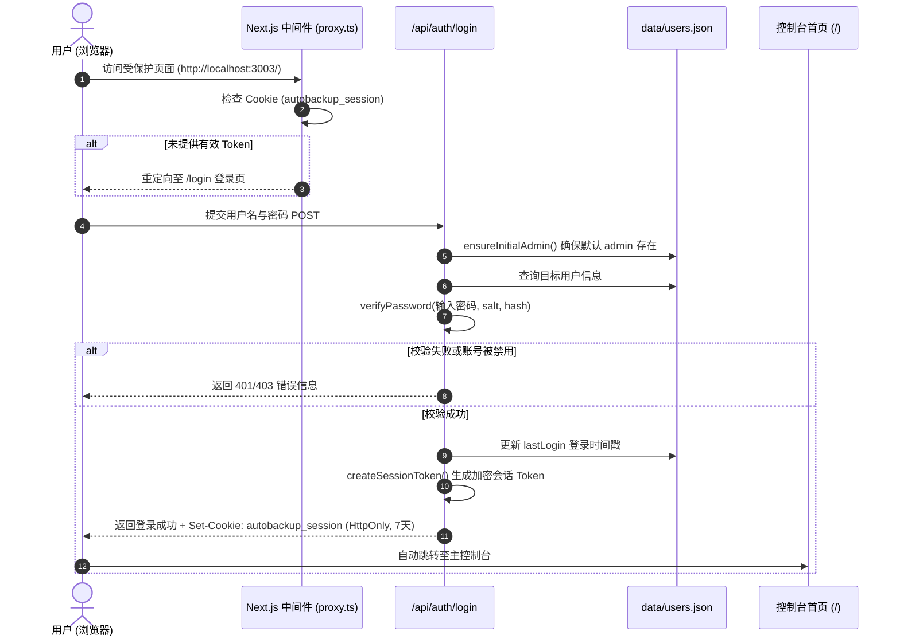
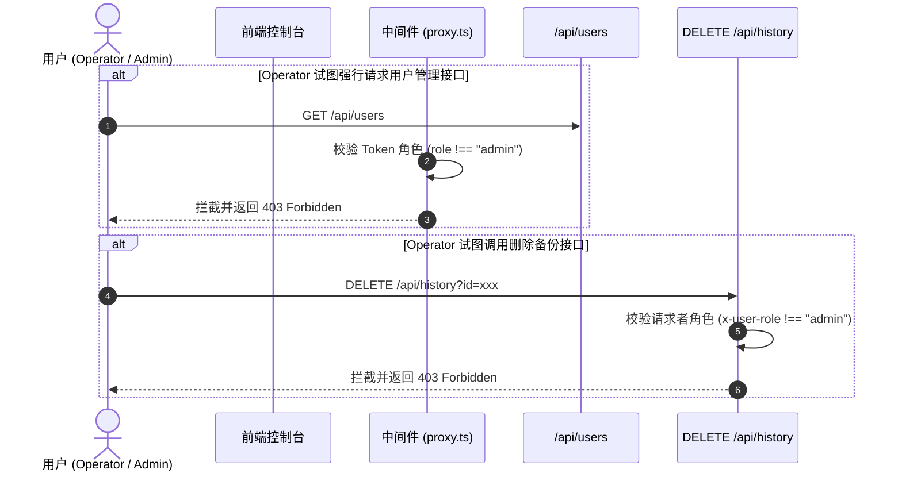

# 登录认证与多用户权限管理功能 (AUTHENTICATION_AND_USER_MANAGEMENT.md)

本文档详细说明 AutoBackup 系统的登录认证体系、本地加盐哈希密码存储机制、Next.js 全局会话中间件、Admin（管理员）与 Operator（操作员）双角色权限隔离（RBAC）以及账号生命周期管理。

---

## 1. 功能概述 (Overview)

系统为保障备份灾备资产与服务器运维的安全，引入了轻量化、零外部数据库依赖的用户认证与权限管控体系：
1. **身份认证**：用户需通过用户名与密码登录系统，未登录用户无法直接访问控制台或调用备份与调度接口；
2. **安全存储**：用户数据持久化存储于 `data/users.json`，使用 Node.js 原生 `crypto.scrypt` 强哈希配合 16 字节随机 Salt 存储密码，杜绝明文泄露风险；
3. **开箱即用 (Out of the Box)**：初次部署并首次启动系统时，若不存在管理员账号，系统将自动初始化内置超级管理员账号 `admin / admin123`；
4. **双角色权限矩阵 (RBAC)**：
   - **Admin（系统管理员）**：拥有全系统所有权限，包含用户管理（添加、启停、重置密码、删除）、全局配置、手动/定时备份、ZIP 下载、物理备份文件与历史记录删除；
   - **Operator（运维操作员）**：日常运维角色，可执行手动备份、增删改查定时调度、查看历史并下载 ZIP 包、修改个人登录密码；**严禁删除历史备份与磁盘物理文件，无权访问用户管理模块**。
5. **操作审计追踪 (Audit Trail)**：每次手动导出均记录操作人用户名（`triggeredBy`），审计记录一目了然。

---

## 2. 角色与权限矩阵 (Role-Based Access Control)

| 权限范围 / 功能操作 | Admin (超级管理员) | Operator (运维操作员) | 未登录用户 |
| :--- | :---: | :---: | :---: |
| **访问控制台首页 (`/`)** | ✅ 允许 | ✅ 允许 | ❌ 自动重定向至 `/login` |
| **控制台登录与注销退出** | ✅ 允许 | ✅ 允许 | ✅ 允许登录 |
| **修改个人登录密码** | ✅ 允许 | ✅ 允许 | ❌ 需登录凭证 |
| **查看 MySQL 状态与数据库列表** | ✅ 允许 | ✅ 允许 | ❌ 拦截返回 401 |
| **执行即时手动导出 (Manual Export)** | ✅ 允许 | ✅ 允许 | ❌ 拦截返回 401 |
| **创建 / 修改 / 启停 / 删除定时任务** | ✅ 允许 | ✅ 允许 | ❌ 拦截返回 401 |
| **流式打包下载备份 ZIP 压缩包** | ✅ 允许 | ✅ 允许 | ❌ 拦截返回 401 |
| **删除历史记录与磁盘物理备份文件** | ✅ 允许 | ❌ **严格禁止** (界面隐藏按钮，API 返回 403) | ❌ 拦截返回 401 |
| **用户账号管理 (查看/新建/禁用/重置/删除)** | ✅ **独占权限** | ❌ **严格禁止** (界面无入口，API 返回 403) | ❌ 拦截返回 401 |

---

## 3. 详细业务流程 (Workflow)

### 3.1 登录与 Session 签发流程

### 3.2 权限拦截与敏感操作控制流程

---

## 4. 使用方式与操作指南 (Usage Guide)

### 4.1 初次部署与首次登录
1. 启动服务：`npm run dev` 或 `npm run start`；
2. 打开浏览器访问：`http://localhost:3003`，系统将自动跳转至 `/login`；
3. 输入初始凭证：
   - **Username**：`admin`
   - **Password**：`admin123`（或在 `.env` 中通过 `INITIAL_ADMIN_PASSWORD` 自定义的初始密码）；
4. 点击 **"Sign In"** 登录成功并进入控制台。

### 4.2 修改个人密码
1. 登录后，在页面顶部右上角点击**钥匙图标**（Change Password）；
2. 弹窗中依次输入：当前密码、新密码（至少 6 位）、确认新密码；
3. 点击 **"Update Password"**，更新成功后下次登录即刻生效。

### 4.3 管理用户账号 (Admin 专属)
1. 以 Admin 身份登录，顶部导航右侧将出现 **"Users"** 专属管理入口；
2. 点击展开 **User & Access Management** 控制面板：
   - **新建账号**：点击 **"+ Add User"**，输入用户名、初始密码并选择角色（`Operator` 或 `Admin`），保存后即刻生成新账号；
   - **重置他人密码**：点击用户行操作列的**钥匙图标**，输入新密码后点击确认重置；
   - **启用/禁用账号**：点击用户行的**电源图标**，可一键挂起离职或临时账号；被禁用的账号在登录时将被拒绝；
   - **删除账号**：点击**垃圾桶图标**确认后删除该账号。
   - *安全防线：系统内置的根账号 `admin` 不允许被禁用、降权或删除；当前登录者无法删除自己。*

---

## 5. 核心业务规则 (Business Rules)

1. **密码安全规则**：
   - 强哈希加盐存储：每个用户独立生成 16 字节随机 Salt，采用 `scrypt` 算法（N=16384, r=8, p=1, keylen=64）运算得到 64 字节安全哈希，抗碰撞与彩虹表攻击；
   - 比较过程采用 `crypto.timingSafeEqual`，抵御时序攻击。
2. **根管理员保底机制 (Root Admin Immunity)**：
   - 内置用户名 `admin` 拥有永久管理员保障，无法被更改角色、无法被禁用、无法被删除，防止误操作导致所有人员被锁在系统外部。
3. **会话安全规则与纵深防御机制 (Multi-Layer Defense & Session Security)**：
   - Cookie 启用 `HttpOnly`（JavaScript 脚本不可读，防 XSS 窃取）；
   - Cookie 启用 `SameSite=Lax` 与 `Path=/`，防范 CSRF 跨站伪造；
   - Cookie 传输安全控制：默认遵循 `NODE_ENV === "production"`，支持通过 `.env` 中的 `COOKIE_SECURE=true/false` 显式覆盖（生产 HTTPS 环境下启用 `Secure` 确保仅加密链路传输；内网 HTTP 部署时可设为 `false` 防止浏览器丢弃 Cookie）；
   - 会话 Token 包含 HMAC-SHA256 服务端签名，篡改任何载荷将导致签名校验失败并失效；
   - **Edge 中间件校验 (L1 防线)**：在 Next.js Edge Middleware 中原生验证 HMAC 签名与过期时间戳，拦截非法请求并重定向至 `/login`，同时主动下发清空指令清除损坏的 Cookie；
   - **服务端实体与激活状态核验 (L2 防线 - `verifyAuthenticatedUser`)**：所有业务 API（数据库、调度、历史、手动导出、系统状态、用户管理）均严格校验 Token 中 `userId` 是否真实存在于 `data/users.json` 且状态处于 `active === true`。如遇账号被注销、禁用或数据重置，API 统一返回 401 并立即通过 `Set-Cookie` 清除浏览器旧 Cookie，根除“幽灵孤儿会话”；
   - **前端认证守卫与 401 联动重定向 (L3 防线)**：控制台首页在初始加载时先行核验 `/api/auth/me`，未通过认证前展示认证检查过渡态，防止未经认证或孤儿会话状态下渲染操作看板；任一接口响应 401 时前端均立即中断并重定向至 `/login`。
4. **审计与操作者追踪**：
   - 所有由用户界面手动触发的备份任务，均会在备份历史记录中写入 `triggeredBy` 属性；
   - 定时任务自动调度触发的备份，记录来源为定时规则名称。

---

## 6. 输入校验与错误处理 (Validation & Error Handling)

| 异常代码 / 场景 | 触发原因 | 处理策略与错误提示 |
| :--- | :--- | :--- |
| **HTTP 400 Bad Request** | 登录、注册或修改密码时缺少必填字段 | 返回提示："Username and password are required" 或 "Please fill in all password fields"。 |
| **HTTP 400 Bad Request** | 用户名包含特殊非法字符或长度小于 3 位 | 拦截并提示："Username must be at least 3 characters long" 或只允许数字字母下划线。 |
| **HTTP 400 Bad Request** | 新密码长度小于 6 位 | 拦截并提示："New password must be at least 6 characters long"。 |
| **HTTP 400 Bad Request** | 修改密码时原密码错误 | 拦截并提示："Incorrect old password"。 |
| **HTTP 400 Bad Request** | 尝试禁用或删除内置根管理员 `admin` | 拦截并提示："Cannot delete/disable the default root admin account"。 |
| **HTTP 400 Bad Request** | 尝试删除自身正在登录的账号 | 拦截并提示："Cannot delete your own account while logged in"。 |
| **HTTP 401 Unauthorized** | 用户名不存在或密码比对不匹配 | 返回提示："Invalid username or password"。 |
| **HTTP 401 Unauthorized** | 未携带有效 Cookie 访问受保护 API | 拦截并提示："Unauthorized: Please log in first"。页面访问时自动重定向至 `/login`。 |
| **HTTP 403 Forbidden** | 账号已被管理员设为禁用状态 (Disabled) | 拦截登录并提示："This account is disabled. Please contact an administrator."。 |
| **HTTP 403 Forbidden** | Operator 角色尝试调用 `/api/users` | 中间件拦截并返回："Forbidden: Admin privilege required"。 |
| **HTTP 403 Forbidden** | Operator 角色尝试调用 `DELETE /api/history` | 接口拦截并返回："Forbidden: Only administrators can delete backup history and files"。 |
| **HTTP 409 Conflict** | 新建用户时用户名与已有用户重复（不区分大小写） | 拦截并提示："Username '{username}' is already taken"。 |

---

## 7. 相关功能文档库

- 📖 [docs/DEPLOYMENT.md](DEPLOYMENT.md) - 开发模式与生产模式部署指南
- ⚙️ [docs/ENV_CONFIGURATION.md](ENV_CONFIGURATION.md) - 环境变量与配置项规范
- 🗄️ [docs/DATABASE_SELECTION.md](DATABASE_SELECTION.md) - 数据库检索与选择功能
- ⚡ [docs/MANUAL_BACKUP.md](MANUAL_BACKUP.md) - 即时手动导出备份功能
- ⏰ [docs/SCHEDULED_BACKUP.md](SCHEDULED_BACKUP.md) - 定时自动备份调度功能
- 📂 [docs/BACKUP_HISTORY_MANAGEMENT.md](BACKUP_HISTORY_MANAGEMENT.md) - 备份历史与文件管理功能
