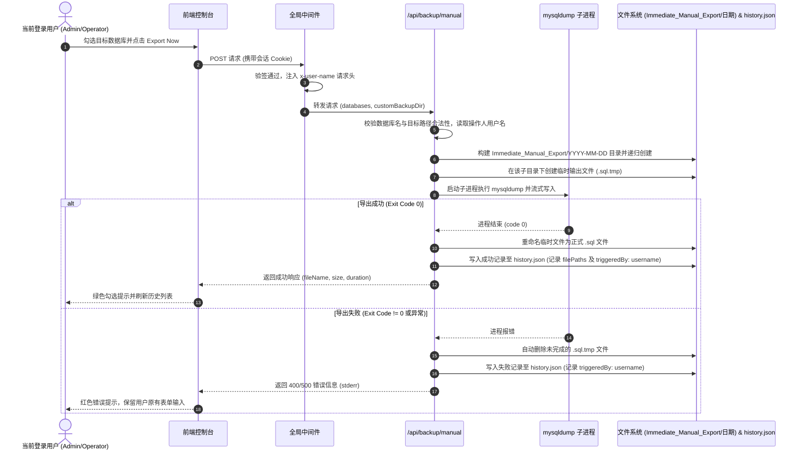

# 即时手动导出备份功能 (MANUAL_BACKUP.md)

本文档详细说明通过 Web 页面立即触发 MySQL 数据库导出的完整流程、mysqldump 封装规则、`Immediate_Manual_Export/YYYY-MM-DD` 分级存储规范与错误保障。

---

## 1. 功能概述

系统已通过权限体系全面保护，已登录的用户（不论是 `Admin` 还是 `Operator` 角色）在界面选择目标数据库后，可指定自定义目标根目录（或直接使用系统默认目录），点击 "Export Now" 按钮立即由后端调用 XAMPP `mysqldump.exe` 进行导出。系统会在目标根目录下自动创建 `Immediate_Manual_Export/` 专属文件夹，并在其内部按当天日期（`YYYY-MM-DD`）创建子目录，将生成的 `.sql` 文件存入其中。同时，后端会自动提取当前登录用户的用户名注入到审计历史中的 `triggeredBy` 字段，实现清晰的操作人追溯。

---

## 2. 详细工作流程 (Workflow)



---

## 3. 存储目录与文件命名规范

1. **手动备份目录层级**：
   - 目标根目录为 `backups/`（或用户自定义路径）；
   - 第一级目录：`Immediate_Manual_Export/`；
   - 第二级目录：`YYYY-MM-DD/`（例如 `2026-09-09/`）；
   - 最终完整路径：`backups/Immediate_Manual_Export/2026-09-09/{db}_{YYYY-MM-DD_HHmmss}.sql`。
2. **智能追加**：
   - 若当天该日期目录已存在，系统直接将新的手动备份文件存入其中，不重复创建或报错。
3. **文件命名格式与多库独立拆分机制**：
   - **单库导出**：`{databaseName}_{YYYY-MM-DD_HHmmss}.sql`（例如 `shop_db_2026-09-10_153000.sql`）；
   - **多库批量导出**：系统依次为每一个选中的数据库独立执行导出，在当前日期目录下分别生成各自专属的 `.sql` 文件（例如 `db1_2026-09-10_153000.sql` 和 `db2_2026-09-10_153000.sql`），彻底杜绝多数据库混杂在单文件内；
   - **ZIP 打包下载命名规范**：
     - 单库导出 ZIP 命名：`{databaseName}_backup_{id}.zip`（例如 `shop_db_backup_b_1789001.zip`）；
     - 多库批量导出 ZIP 命名：`multiple_{count}_dbs_backup_{id}.zip`（例如 `multiple_3_dbs_backup_b_1789001.zip`），同一个压缩包内并列包含各个独立的 `.sql` 脚本文件。
4. **`mysqldump` 参数组合**：
   - `--routines`：导出存储过程和自定义函数；
   - `--triggers`：导出数据表关联的触发器；
   - `--single-transaction`：针对 InnoDB 引擎开启一致性非阻塞快照导出，避免锁死生产表。

---

## 4. 错误处理与容错机制

| 错误类型 | 触发原因 | 处理策略 |
| :--- | :--- | :--- |
| **未登录或会话过期** | Cookie 缺失或签名失效 | 全局中间件拦截并重定向至 `/login` 登录页，保护 API 安全。 |
| **未选数据库** | 用户未勾选任何库 | 前端阻止请求并给出提示。 |
| **路径无写权限** | 目标目录为只读或系统保护目录 | 后端在 `fs.access` 阶段拦截并报错返回。 |
| **mysqldump 不存在** | `.env` 路径配置错误 | 记录失败审计，提示检查 XAMPP 安装路径。 |
| **磁盘空间不足** | 写入过程中磁盘满 | 触发进程异常，自动清理残缺 `.tmp` 文件并返回明确错误。 |

---

## 5. 接口规范 (API Specification)

### `POST /api/backup/manual`
- **请求权限**：需要有效登录会话（Admin 或 Operator 均可）。
- **请求载荷 (JSON Payload)**：
  ```json
  {
    "databases": ["petty_cash_claim", "semipack_traceability"],
    "customBackupDir": "D:\\mysql_backups"
  }
  ```
  - `databases`（必填，string[]）：需要导出的数据库名称数组；
  - `customBackupDir`（可选，string）：自定义输出根目录，不传则使用系统默认的 `DEFAULT_BACKUP_DIR`。
- **成功响应示例**（HTTP 200）：
  ```json
  {
    "success": true,
    "item": {
      "id": "b_1792024907051_opt862",
      "timestamp": "2026-10-15T00:41:47.051Z",
      "triggerType": "manual",
      "triggeredBy": "admin",
      "databases": ["semipack_traceability"],
      "sourceFolders": [],
      "filePath": "C:\\xampp\\htdocs\\autobackup\\backups\\Immediate_Manual_Export\\2026-10-15\\semipack_traceability_2026-10-15_084144.sql",
      "filePaths": [
        "C:\\xampp\\htdocs\\autobackup\\backups\\Immediate_Manual_Export\\2026-10-15\\semipack_traceability_2026-10-15_084144.sql"
      ],
      "targetDirectory": "C:\\xampp\\htdocs\\autobackup\\backups\\Immediate_Manual_Export\\2026-10-15",
      "fileName": "Immediate_Manual_Export/2026-10-15/semipack_traceability_2026-10-15_084144.sql",
      "fileSize": 222523,
      "durationMs": 2725,
      "status": "SUCCESS",
      "hasFolders": false,
      "errorMessage": null
    }
  }
  ```

---

## 6. 相关功能文档库

- 🗄️ [docs/DATABASE_SELECTION.md](DATABASE_SELECTION.md) - 数据库检索与选择功能
- 📂 [docs/BACKUP_HISTORY_MANAGEMENT.md](BACKUP_HISTORY_MANAGEMENT.md) - 备份历史与文件管理功能
- ⏰ [docs/SCHEDULED_BACKUP.md](SCHEDULED_BACKUP.md) - 定时自动备份调度功能
- 🔐 [docs/AUTHENTICATION_AND_USER_MANAGEMENT.md](AUTHENTICATION_AND_USER_MANAGEMENT.md) - 用户登录认证与权限控制 (RBAC)

