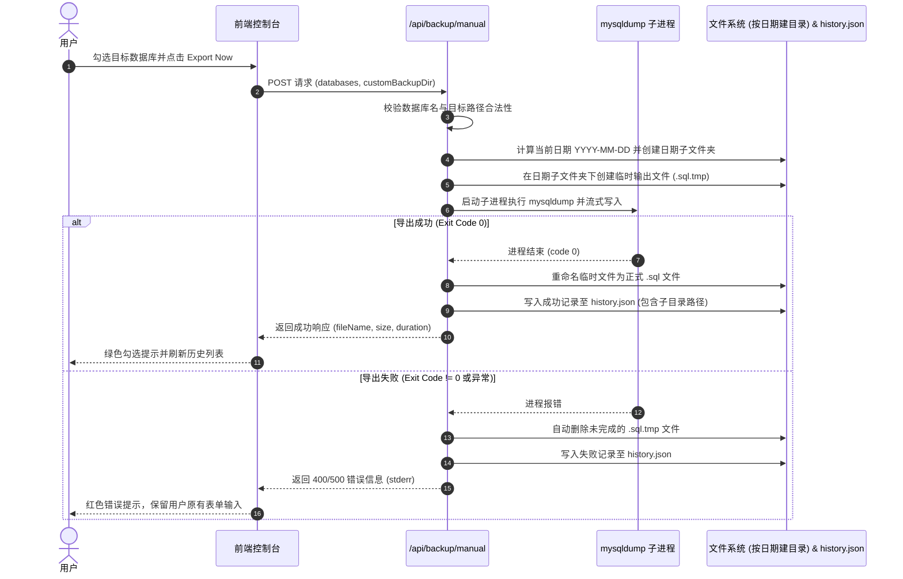

# 即时手动导出备份功能 (MANUAL_BACKUP.md)

本文档详细说明通过 Web 页面立即触发 MySQL 数据库导出的完整流程、mysqldump 封装规则、按日期分文件夹存储规范与错误保障。

---

## 1. 功能概述

用户在界面选择目标数据库后，可指定自定义目标根目录（或直接使用系统默认目录），点击 "Export Now" 按钮立即由后端调用 XAMPP `mysqldump.exe` 进行导出。系统会在目标目录下**自动以当天日期（YYYY-MM-DD）创建子文件夹**并生成标准的 `.sql` 文件，如果文件夹已存在则自动存入该文件夹中。

---

## 2. 详细工作流程 (Workflow)

---

## 3. 存储目录与文件命名规范

1. **按日期自动分文件夹归类**：
   - 目标根目录为 `backups/`（或自定义路径）；
   - 系统自动生成子目录 `backups/YYYY-MM-DD/`（例如 `backups/2026-09-09/`）；
   - **智能追加**：若当天日期文件夹已存在，直接存入其中，不重复创建或报错。
2. **文件命名格式**：
   - 单库导出：`{databaseName}_{YYYY-MM-DD_HHmmss}.sql`（例如 `shop_db_2026-09-09_140000.sql`）；
   - 多库批量导出：`multiple_{count}_dbs_{YYYY-MM-DD_HHmmss}.sql`。
3. **`mysqldump` 参数组合**：
   - `--routines`：导出存储过程和自定义函数；
   - `--triggers`：导出数据表关联的触发器；
   - `--single-transaction`：针对 InnoDB 引擎开启一致性非阻塞快照导出，避免锁死生产表。
4. **临时文件安全防护**：
   - 导出中一律先写入 `.tmp` 临时文件；
   - 必须在子进程退出码为 `0` 时才执行 `fs.renameSync`；
   - 发生任何错误时，立即执行清理删除临时文件，防止产生半截的损坏 SQL。

---

## 4. 错误处理与容错机制

| 错误类型 | 触发原因 | 处理策略 |
| :--- | :--- | :--- |
| **未选数据库** | 用户未勾选任何库 | 前端阻止请求并给出提示。 |
| **路径无写权限** | 目标目录为只读或系统保护目录 | 后端在 `fs.access` 阶段拦截并报错返回。 |
| **mysqldump 不存在** | `.env` 路径配置错误 | 记录失败审计，提示检查 XAMPP 安装路径。 |
| **SQL 语法或权限异常** | 数据库损坏或表锁 | 捕获 `stderr` 详细输出并记录到失败历史中。 |
| **磁盘空间不足** | 写入过程中磁盘满 | 触发进程异常，自动清理残缺 `.tmp` 文件并返回明确错误。 |
