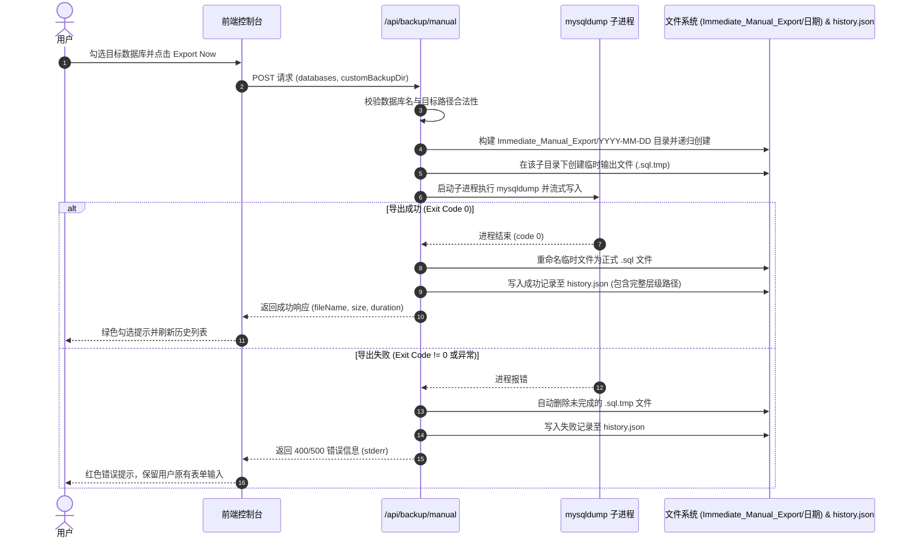

# 即时手动导出备份功能 (MANUAL_BACKUP.md)

本文档详细说明通过 Web 页面立即触发 MySQL 数据库导出的完整流程、mysqldump 封装规则、`Immediate_Manual_Export/YYYY-MM-DD` 分级存储规范与错误保障。

---

## 1. 功能概述

用户在界面选择目标数据库后，可指定自定义目标根目录（或直接使用系统默认目录），点击 "Export Now" 按钮立即由后端调用 XAMPP `mysqldump.exe` 进行导出。系统会在目标根目录下自动创建 `Immediate_Manual_Export/` 专属文件夹，并在其内部按当天日期（`YYYY-MM-DD`）创建子目录，将生成的 `.sql` 文件存入其中。

---

## 2. 详细工作流程 (Workflow)

---

## 3. 存储目录与文件命名规范

1. **手动备份目录层级**：
   - 目标根目录为 `backups/`（或用户自定义路径）；
   - 第一级目录：`Immediate_Manual_Export/`；
   - 第二级目录：`YYYY-MM-DD/`（例如 `2026-09-09/`）；
   - 最终完整路径：`backups/Immediate_Manual_Export/2026-09-09/{db}_{YYYY-MM-DD_HHmmss}.sql`。
2. **智能追加**：
   - 若当天该日期目录已存在，系统直接将新的手动备份文件存入其中，不重复创建或报错。
3. **文件命名格式与多库独立拆分机制**：
   - **单库导出**：`{databaseName}_{YYYY-MM-DD_HHmmss}.sql`（例如 `shop_db_2026-09-10_153000.sql`）；
   - **多库批量导出**：系统依次为每一个选中的数据库独立执行导出，在当前日期目录下分别生成各自专属的 `.sql` 文件（例如 `db1_2026-09-10_153000.sql` 和 `db2_2026-09-10_153000.sql`），彻底杜绝多数据库混杂在单文件内；
   - **ZIP 打包下载**：点击下载时，同一个 ZIP 压缩包内将并列包含各个独立的 `.sql` 脚本文件。
4. **`mysqldump` 参数组合**：
   - `--routines`：导出存储过程和自定义函数；
   - `--triggers`：导出数据表关联的触发器；
   - `--single-transaction`：针对 InnoDB 引擎开启一致性非阻塞快照导出，避免锁死生产表。

---

## 4. 错误处理与容错机制

| 错误类型 | 触发原因 | 处理策略 |
| :--- | :--- | :--- |
| **未选数据库** | 用户未勾选任何库 | 前端阻止请求并给出提示。 |
| **路径无写权限** | 目标目录为只读或系统保护目录 | 后端在 `fs.access` 阶段拦截并报错返回。 |
| **mysqldump 不存在** | `.env` 路径配置错误 | 记录失败审计，提示检查 XAMPP 安装路径。 |
| **SQL 语法或权限异常** | 数据库损坏或表锁 | 捕获 `stderr` 详细输出并记录到失败历史中。 |
| **磁盘空间不足** | 写入过程中磁盘满 | 触发进程异常，自动清理残缺 `.tmp` 文件并返回明确错误。 |
