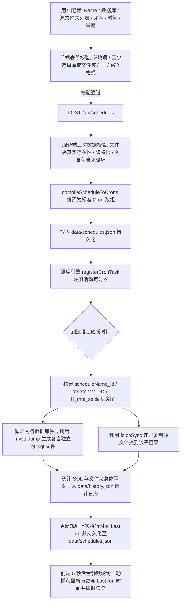

# 定时自动备份调度功能 (SCHEDULED_BACKUP.md)

本文档详细说明系统基于内置 Cron 引擎实现的可视化周期性自动备份调度机制、MySQL 数据库导出与源文件夹（Source Folders）递归复制备份、多时间点选择、智能 Cron 编译与 `scheduleName_id/YYYY-MM-DD/HH_mm_ss` 深度分层归档存储规范。

---

## 1. 功能概述

系统提供全可视化的定时备份调度能力。已登录的管理员（Admin）与操作员（Operator）均拥有调度规则的完整管理权限，可以自由查看、创建、编辑启停状态与删除定时规则。用户不仅可以选择需要定时备份的 MySQL 数据库，还可以配置一个或多个**磁盘源文件夹路径（Source Folders）**（例如项目的 `uploads/`、用户资料目录或资产文件夹）。系统在到达设定周期时，将自动调用 `mysqldump` 导出数据库，并递归复制选中的源文件夹至深度归档目录中。定时任务由服务端后台引擎自动触发，在审计历史中触发源记录为该规则的名称。

---

## 2. 深度归档存储结构

针对自动调度任务，系统按以下层级自动组织存储：

```text
backups/ (备份根目录)
  └── {scheduleName}_{scheduleId}/                  <-- 第一层: 规则专属目录 (特殊字符安全转义)
        └── {YYYY-MM-DD}/                           <-- 第二层: 执行当天日期
              └── {HH_mm_ss}/                       <-- 第三层: 执行具体时间 (时_分_秒)
                    ├── {db_name}_{时间戳}.sql       <-- 导出的 SQL 文件
                    ├── uploads/                    <-- 递归备份的源文件夹 1
                    └── assets/                     <-- 递归备份的源文件夹 2
```

---

## 3. 如何使用 (How to Use)

### 3.1 新建调度规则（包含数据库与文件夹）
1. 在 **Automated Schedules** 区域点击 **"New Schedule"** 展开配置面板；
2. **输入规则名称**（如 `Daily Core DB & Uploads Backup`）；
3. **选择数据库（可选）**：勾选需要备份的 MySQL 数据库；
4. **选择源文件夹（可选，支持直接输入或可视化浏览选择）**：
   - **方式一（直接输入）**：在输入框直接填入文件夹绝对路径（如 `C:\xampp\htdocs\my_project\uploads`）后点击 **"Add Folder"**（或直接按键盘回车键）；
   - **方式二（可视化浏览点选）**：**若输入框为空时点击按钮，或点击输入框右侧的文件夹浏览图标**，系统将自动呼出**目录浏览选择弹窗（Directory Picker Modal）**。用户可直观在可视界面中快速切换驱动器盘符（`C:\`、`D:\` 或当前项目根目录），通过双击或点击 Open 逐级展开各层级子文件夹，单选目标文件夹后点击 **"Select This Folder"** 即可自动将真实绝对路径填入并添加至备份列表；
   - 支持多次添加多个不同的源文件夹；列表中每个文件夹项均配备专属标签与 `✕` 移除按钮；
   - *注：数据库与源文件夹至少选择一项。*
5. **选择备份频率类型 (Backup Frequency)**：
   - **Every Hour（每小时）**：固定在每小时整点（`XX:00`）执行；
   - **Daily（每日）**：初始不预设任何时间，由用户自主输入并点击 **"+ Add Time"** 添加一个或多个具体时间点（`HH:mm`）；
   - **Weekly（每周）**：初始不预选星期和时间，由用户自主点选周一至周日的任意天数 + 添加一个或多个具体时间点；
6. **指定输出目录（可选）**：留空使用默认目录，或填入自定义路径；
7. 点击 **"Save Schedule"** 提交保存，后台即刻启动监听。

---

## 4. 详细工作流程 (Workflow)



---

## 5. 输入校验规则 (Validation)

1. **资源非空校验**：数据库列表与源文件夹列表至少选择一项，不能两者皆为空；
2. **源文件夹合法性校验**：
   - 路径必须在服务器磁盘上真实存在；
   - 必须是目录（Directory）而非单一普通文件；
   - Node.js 进程必须具备读取权限（`fs.constants.R_OK`）；
   - **防自包含死循环校验（Anti-Self-Recursion）**：源文件夹绝对不能是备份目标根目录自身或包含备份根目录，杜绝无限嵌套递归导致磁盘被撑爆；
3. **Daily / Weekly 模式**：必须包含至少 1 个有效的时间点（`HH:mm`）；Weekly 模式必须至少选择 1 天（`0-6`）；
4. **规则名称安全过滤**：自动将规则名称中的空格及特殊字符转换为下划线 `_`。

---

## 6. 错误处理机制 (Error Handling)

| 异常情况 | 触发原因 | 处理策略 |
| :--- | :--- | :--- |
| **源文件夹不存在或为普通文件** | 输入了错误的路径或误选了文件 | 前后端在校验阶段直接拦截并给出具体路径错误提示，阻止保存。 |
| **源文件夹包含备份目标目录** | 用户配置将 `backups` 复制进 `backups` | 触发自包含拦截："Cannot backup the backup destination directory itself"。 |
| **文件被外部占用 (EBUSY)** | 复制过程中个别日志或图片正被其他进程打开 | 捕获锁定错误并记录详细错误日志，避免进程崩溃。 |
| **磁盘空间不足 (ENOSPC)** | 复制大文件夹过程中磁盘写满 | 自动中断写入，清理当前未完成的临时文件碎片，并记录状态为 `FAILED` 的历史日志。 |
| **执行时 MySQL 临时离线** | 仅备份数据库时 MySQL 未启动 | 捕获连接错误，记录失败日志；若同时配置了文件夹备份，仍会保证文件夹正常复制完成。 |
