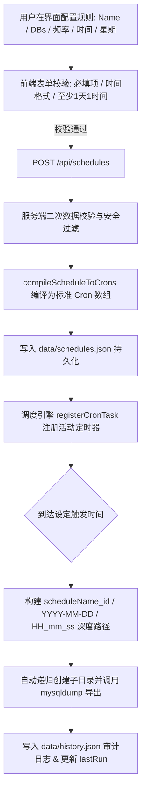

# 定时自动备份调度功能 (SCHEDULED_BACKUP.md)

本文档详细说明系统基于内置 Cron 引擎实现的可视化周期性自动备份调度机制、三档频率模式（Every Hour、Daily、Weekly）、多时间点选择、智能 Cron 编译与 `scheduleName_id/YYYY-MM-DD/HH_mm_ss` 深度分层归档存储规范。

---

## 1. 功能概述

系统提供全可视化的定时备份调度能力。用户直接通过图形界面选择备份频率（**Every Hour**、**Daily**、**Weekly**），自由添加一天中的一个或多个具体时间点（`HH:mm`），或自由多选周一至周日的任意天数。系统按时自动触发 `mysqldump` 导出指定的 MySQL 数据库，并在目标目录下**以 `scheduleName_id/YYYY-MM-DD/HH_mm_ss/` 的深度三级目录结构精准归档**。

---

## 2. 深度三级归档存储结构

针对自动调度任务，系统按以下层级自动组织存储：

```text
backups/ (备份根目录)
  └── {scheduleName}_{scheduleId}/                  <-- 第一层: 规则专属目录 (特殊字符安全转义)
        └── {YYYY-MM-DD}/                           <-- 第二层: 执行当天日期
              ├── {HH_mm_ss}/                       <-- 第三层: 执行具体时间 (时_分_秒)
              │     └── {db_name}_{时间戳}.sql
              └── {另一执行时间 HH_mm_ss}/
                    └── {db_name}_{时间戳}.sql
```

### 实际路径范例：
`backups/Daily_Core_DB_sched_1788938/2026-09-09/09_00_00/shop_db_2026-09-09_090000.sql`

---

## 3. 详细工作流程 (Workflow)



---

## 4. 智能 Cron 编译规则与原理

| 频率模式 | 前端选择配置 | 底层编译生成的 Cron 表达式数组 | 执行行为说明 |
| :--- | :--- | :--- | :--- |
| **Every Hour** | 选中 Every Hour | `["0 * * * *"]` | 每小时的第 00 分钟执行一次 |
| **Daily** | `times: ["09:00", "18:30"]` | `["0 9 * * *", "30 18 * * *"]` | 分别在每天 09:00 和 18:30 各精准触发一次 |
| **Weekly** | `weekDays: [1, 3, 5]`<br>`times: ["02:00", "22:15"]` | `["0 2 * * 1,3,5", "15 22 * * 1,3,5"]` | 每周一、三、五的 02:00 和 22:15 各精准触发一次 |

---

## 5. 输入校验规则 (Validation)

1. **规则名称**：必填，不能为空字符串；系统自动将名称中的空格及特殊字符转换为安全字符 `_` 用于目录创建；
2. **数据库列表**：必选，至少包含 1 个合法的数据库名称（正则 `^[a-zA-Z0-9_\-$]+$`）；
3. **Daily 模式**：必须包含至少 1 个有效的时间点（标准 `HH:mm`）；
4. **Weekly 模式**：必须选择至少 1 个星期天数（`0-6`），且包含至少 1 个有效的时间点；
5. **多级目录自动创建**：系统自动调用递归创建逻辑，如果已存在则直接存入；
6. **服务端二次编译校验**：编译生成的每一条 Cron 表达式均须通过 `cron.validate()` 验证。

---

## 6. 错误处理机制 (Error Handling)

| 异常情况 | 触发原因 | 处理策略 |
| :--- | :--- | :--- |
| **规则名称含非法路径字符** | 包含 `\ / : * ? " < > \|` 或空格 | 系统自动调用 `sanitizeFolderName` 转换为安全下划线 `_`。 |
| **未添加任何时间点** | 在 Daily/Weekly 模式下清空了所有时间 | 前端拦截并提示；服务端返回 400 状态。 |
| **执行时 MySQL 临时离线** | 定时器到达但 XAMPP MySQL 处于关停状态 | 调度器捕获错误，记录状态为 `FAILED` 的历史记录（注明连接被拒绝），主服务常驻进程不崩溃。 |
| **输出目录被外部删除** | 定时触发前目标目录被其他软件清理 | 导出引擎自动递归重新创建该三级目录后再行导出。 |
